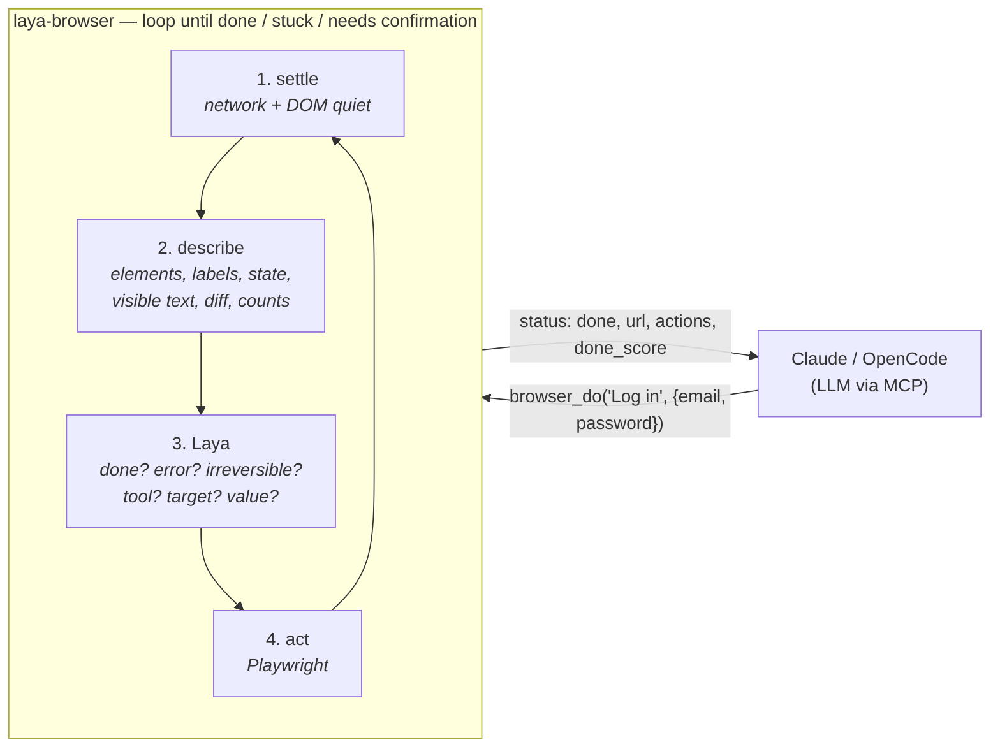

# laya-browser

**Browser automation where an LLM plans, [Laya](https://huggingface.co/cklxx/laya-browser) decides, and Playwright acts.**

[](LICENSE)
[](https://nodejs.org/)

A fork of [jev-browser](https://github.com/Ying-Kai-Liao/jev-browser) that uses **Laya as its local decision system** for browser automation. It preserves the original project's browser automation architecture, MIT license, and attribution.

Configure `JEV_BACKEND=laya` to use the local decision system, without a TypeSafe API key. The original Jev backend remains available for compatibility; an unconfigured installation still selects `jev`. See [Local Laya backend](#local-laya-backend-cpu-or-cuda) for setup.

https://github.com/user-attachments/assets/2e688df9-4985-4854-8ebe-ba97c9d13d68

---

## Contents

- [How it works](#how-it-works)
- [Jev vs. Laya: reproducible comparison](#jev-vs-laya-reproducible-comparison)
- [Results inherited from jev-browser](#results-inherited-from-jev-browser)
- [Quick start (MCP, from npm)](#quick-start-mcp-from-npm)
- [Setup (from source)](#setup-from-source)
  - [Local Laya backend (CPU or CUDA)](#local-laya-backend-cpu-or-cuda)
  - [Monitor Laya resources](#monitor-laya-resources)
  - [Use from Claude Code](#use-from-claude-code-mcp-from-source)
  - [Decision cache](#decision-cache-replay-without-jev)
  - [Library](#library)
  - [Watch it](#watch-it)
  - [CLI](#cli)
- [Writing good steps](#writing-good-steps)
- [Cost: what the caller pays and what Jev spends](#cost-what-the-caller-pays-and-what-jev-spends)
- [Benchmark](#benchmark)
- [Layout](#layout)
- [Releasing](#releasing)
- [License](#license)

---

## How it works

The calling LLM (Claude, OpenCode, or any MCP client) says what outcome it wants, one step at a time, and hands over any text to type. For each round of a step, code describes the page. The local Laya decision system evaluates the next operation and target, along with auxiliary questions: which element, which action, which value, and is the step done / blocked / showing an error / about to do something irreversible. Playwright performs the action. The LLM never reads page snapshots unless it chooses to take over.



Laya answers typed questions with probability distributions: yes/no (`noul`), pick one option (`choice`) or a rating (`score`). It never writes text. So everything free-form comes from the caller as candidates, and code turns disagreement or low confidence into a status the LLM can act on.

---

## Jev vs. Laya: reproducible comparison

Five local examples compare field entry, a checkbox, a dropdown, search, and task creation with both decision backends. See [examples/comparison](examples/comparison/README.md) for setup and [BENCHMARK-JEV-LAYA.md](BENCHMARK-JEV-LAYA.md) for measured results.

```bash
npm run bench:compare -- --repetitions 3
```

The runner executes Jev first and Laya second, disables the decision cache, and checks the DOM after each step. It reports decision latency, execution time, request counts, and token usage when provided by the backend.

### Benchmark summary: Jev vs. Laya CPU vs. Laya AMD GPU

Measured on October 10, 2026: five identical local examples, three repetitions per configuration, headless browser, decision cache disabled, and DOM assertions.

| Metric | Jev remote API | Laya local CPU | Laya local AMD GPU |
|---|--:|--:|--:|
| Mean decision request latency | 250.51 ms | 2,715.35 ms | 951.30 ms |
| Median decision request latency | 236.53 ms | 2,657.69 ms | 901.28 ms |
| P95 decision request latency | 321.81 ms | 3,458.79 ms | 1,183.91 ms |
| Total execution time for 15 tasks | 21.38 s | 98.48 s | 40.11 s |
| Measured decision requests | 43 | 33 | 33 |
| Goals achieved in the DOM | 15/15 | 9/15 | 9/15 |
| Completions confirmed by status and DOM | 12/15 | 9/15 | 9/15 |
| Reported input / output tokens, measured tasks | 52,417 / 10,311 | Not measured | Not measured |

**Local computer:** Ubuntu 22.04.5 LTS, kernel `6.8.0-138-generic`, Intel Core i5-11400F @ 2.60 GHz (6 cores / 12 threads), 23.31 GiB system-reported RAM, and AMD Radeon RX 6600 (`gfx1032`, 8 GB nominal VRAM). Node.js 24.15.0 and Python 3.11.16 were used. CPU inference used PyTorch `2.14.1+cu130` on CPU; GPU inference used `2.16.0a0+rocm10.2.0a20261010` with ROCm and both models on `cuda:0`.

> Laya's mean request latency improved **2.85× with AMD GPU** relative to the CPU run. GPU execution was measured separately with a different PyTorch build. Jev's remote inference hardware is unknown; the local specifications describe its browser/client, not the TypeSafe server. Request latency includes networking and response processing. Laya's internal token counts are not measured, not zero.

See [BENCHMARK-JEV-LAYA.md](BENCHMARK-JEV-LAYA.md) for the full hardware table, methodology, and interpretation, and [ROCM-AMD.md](ROCM-AMD.md) for the verified AMD GPU setup.

---

## Results inherited from jev-browser

> **Note:** The results below come from the original project's **Jev backend**, not from Laya. They document the upstream implementation; see the local Laya setup section for the current adapter's supported operations and verification examples.

42 tasks in 16 categories on live sites (see [RESULTS.md](RESULTS.md)):

- **40/42 correct in the latest run, 0 false "done" claims** (38/41 twice before the latest fixes). Remaining misses: counting ("add until 3", flagged `likely_done`) and verifying a sort.
- **~300 ms per Jev call**, 2–4 calls for most steps; a 5-step checkout takes ~14 s end to end.
- **Pause before irreversible actions**: across ~200 rounds it flagged only saucedemo's "Finish" (place order) button.
- **Less page content for the LLM** than a Playwright-MCP-style loop on the same tasks (estimate): median 5× per task, ≈8k vs ≈557k tokens in total. Big pages dominate the total: a Wikipedia article is ~149k snapshot tokens. On tiny pages there is no saving. The page reading moves to Jev.

**Works on:** forms, native and custom dropdowns, checkboxes and radios (including styled replacements), dynamic loading, modals, JS dialogs, hover, right-click, drag and drop, key presses, file upload, iframes, shadow DOM, new tabs, pages with 2,000+ elements (two-stage selection), and non-English UIs.

Element discovery includes DOM event properties (`element.onclick`), React event props, and direct native listeners registered after browser startup. This also detects custom sidebar/card controls whose pointer cursor appears only on hover, without requiring a prior mouse movement. Hidden/inert controls stay excluded.

**Known limits** — write steps around them:

- **Ordered sub-goals in one step** ("add two todos, complete one, clear completed") → split into one outcome per step.
- **Open-ended goals** ("scroll to load more") → make them measurable or check yourself.
- **Judgements that compare many values** (is this table sorted, did exactly one thing change) → verify with `browser_check` or `browser_snapshot`.

---

## Quick start (MCP, from npm)

```bash
npx playwright install chromium          # once
claude mcp add laya-browser -e TYPESAFE_API_KEY=your-key -- npx -y -p laya-browser laya-browser-mcp
```

Any MCP client works the same way: command `npx`, args `-y -p laya-browser laya-browser-mcp`, env `TYPESAFE_API_KEY`. Add `JEV_BROWSER_HEADED=1` to watch it work.

---

## Setup (from source)

```bash
git clone https://github.com/MendiburuFrancisco/laya-browser && cd laya-browser
npm install
npm run setup                    # downloads Chromium for Playwright
cp .env.example .env             # add TYPESAFE_API_KEY
npm test                         # offline tests (no network, no key)
npm run test:e2e                 # MCP server end to end (network + key)
```

### Local Laya backend (CPU or CUDA)

This fork uses the [cklxx/laya-browser model on Hugging Face](https://huggingface.co/cklxx/laya-browser) as its browser decision checkpoint. It is a fine-tuned version of [Laya](https://huggingface.co/convaiinnovations/laya), a non-autoregressive model that answers typed questions without generating text.

**Requirements:** Python 3.11+, Node.js 20+, and Internet access for the initial dependency installation and model download. CPU execution is supported; CUDA execution requires an NVIDIA GPU and a CUDA-compatible PyTorch installation.

### Browser downloads

Files downloaded through the browser are saved persistently under `~/Downloads/laya-browser` by default. Set `JEV_BROWSER_DOWNLOADS_DIR` in the MCP server environment to choose another directory. The MCP tools `browser_downloads` and `browser_wait_for_download` report the download status and the absolute path on the machine running the MCP server. `browser_run` steps can verify a download with `verify: { "download": { "filename": "report.csv", "timeout_ms": 30000 } }`.

> **AMD GPUs:** use a compatible **ROCm build of PyTorch**. See [ROCM-AMD.md](ROCM-AMD.md) for the RX 6600 installation verified with this project. PyTorch also uses `--device cuda` for AMD ROCm; `/health` reports the actual accelerator and the devices of both models.

#### 1. Install the Laya Python package

From the repository root, create an isolated environment with [uv](https://docs.astral.sh/uv/getting-started/installation/) and install the project's pinned Laya dependency (`laya==0.4.2`):

```bash
uv venv --python 3.11 .venv
uv pip install --python .venv/bin/python -r local/requirements.txt
```

Alternatively, use Python's built-in virtual environment and pip:

```bash
python3.11 -m venv .venv
.venv/bin/python -m pip install -r local/requirements.txt
```

#### 2. Download the models and start the local server

For CPU:

```bash
.venv/bin/python local/laya_server.py --model cklxx/laya-browser --device cpu
```

For CUDA:

```bash
.venv/bin/python local/laya_server.py --model cklxx/laya-browser --device cuda
```

The first launch automatically downloads **two checkpoints** from Hugging Face:

- [`cklxx/laya-browser`](https://huggingface.co/cklxx/laya-browser): selects browser operations and target elements.
- [`convaiinnovations/laya`](https://huggingface.co/convaiinnovations/laya): answers auxiliary questions, including checks, values, errors, and irreversible actions.

Subsequent launches reuse the Hugging Face cache. Keep this terminal running and wait for the `Laya ready` message before connecting the browser.

To download the checkpoints into the Hugging Face cache ahead of time:

```bash
.venv/bin/python -c 'from huggingface_hub import snapshot_download; snapshot_download("cklxx/laya-browser"); snapshot_download("convaiinnovations/laya")'
```

If you already have local copies, pass their directories with `--model /absolute/path/to/laya-browser` and `--checks-model /absolute/path/to/laya`.

#### 3. Verify readiness and connect the browser

In a second terminal, check that both models have loaded:

```bash
curl http://127.0.0.1:8791/health
```

The response should contain `"ok": true`, the model IDs or paths, and the selected device. Then run the browser against the local server:

```bash
JEV_BACKEND=laya JEV_CACHE=0 node bin/laya-browser.mjs run examples/flows/laya-smoke.json --headed
```

For MCP, set `JEV_BACKEND=laya` in the server environment or in the repository's `.env`. No TypeSafe API key is required. `JEV_API_URL` overrides the default `http://127.0.0.1:8791/v1/systemone`. Check readiness at `/health`. For example, add these settings to `.env`:

```dotenv
JEV_BACKEND=laya
JEV_API_URL=http://127.0.0.1:8791/v1/systemone
JEV_CACHE=0
```

For step-by-step MCP configuration in Spanish, see [MCP-LAYA.md](MCP-LAYA.md).

> Use a separate `JEV_CACHE_FILE=.laya-cache.json` when enabling the decision cache to avoid replaying decisions previously made by Jev.

<details>
<summary><strong>Adapter details and caveats</strong> (click to expand)</summary>

The adapter preserves this project's page/task schema, supplies descriptions for element and group choices, and splits choices wider than 60 candidates. The browser checkpoint chooses CLICK, TYPE_TEXT, SELECT, PRESS_ENTER, SCROLL_DOWN, WAIT, DONE and BLOCKED in an operation-specific target layout. General Laya handles auxiliary typed questions (values, checks, login, error, irreversible actions, and group selection); the browser checkpoint's yes/no head saturated during initial testing. Both checkpoints run locally. `--checks-model` selects a different general checkpoint.

Hover, drag, right-click, upload and other keyboard actions remain available through manual `browser_act`; the local browser policy does not propose those operations. This is a different question format from the model's original jev-ultrafast evaluation harness; its published benchmark scores do not apply to this adapter. The model may stop early or request confirmation on benign actions; verify results with page assertions. The existing multi-step TodoMVC flow is not a passing Laya benchmark. `laya-smoke.json` is a small field-entry example with a DOM assertion. The browser still receives strings to type through `values`, so no additional text-generation model is needed. The default backend remains `jev`.

</details>

### Monitor Laya resources

On Linux, with the Laya server running, launch a dashboard that graphs only the server process (CPU and resident RAM), sampled every second:

```bash
node local/monitor-laya.mjs
```

Open the printed `http://127.0.0.1:8792` URL in a browser. CPU is expressed as a percentage of one core; the graphs show the most recent 90 seconds.

### Use from Claude Code (MCP, from source)

```bash
claude mcp add laya-browser -- node /absolute/path/to/laya-browser/bin/laya-browser-mcp.mjs
```

From a source checkout the server reads `TYPESAFE_API_KEY` from the repo's `.env`.

**Available tools:**

| tool | purpose |
|---|---|
| `browser_open(url, viewport?)` | navigate and wait; viewport object fixes resolution, null follows window size |
| `browser_do(goal, values?, max_actions?, allow_irreversible?, explain?)` | work toward one outcome; returns a status |
| `browser_run(steps, url?, viewport?)` | run an ordered plan locally; return only on completion or the first problem |
| `browser_execute(code, values?, ...)` | compose browser operations in isolated JavaScript; works with Laya and Jev |
| `browser_check(question)` | yes/no about the page → `p_yes` |
| `browser_choose(question, options)` | pick among given options → distribution |
| `browser_snapshot(diff?, interactive?, filter?, urls?, max_chars?)` | compact numbered element list, for taking over; the options below narrow it |
| `browser_act(action, element, value?, key?, destination?, accept_dialog?)` | act on an element directly, no model; confirm/prompt dialogs are dismissed unless `accept_dialog` |
| `browser_read(question, max_chars?)` | the page text that helps answer a question; Jev drops the rest |
| `browser_screenshot(full_page?)` | PNG image |
| `browser_close()` | end the session |

### Code Mode: compose operations in one MCP call

`browser_execute` implements the [Code Mode pattern](https://blog.cloudflare.com/code-mode/):
the **calling LLM writes a program**, and the MCP server executes its intermediate
logic without returning to the LLM after every operation. **Laya and Jev remain
typed decision backends; neither is asked to generate code.** Select either using
the existing `JEV_BACKEND` setting. Backend selection remains per server process.

Pass a **JavaScript async function body**, JSON `values`, and return the data needed
by the caller. TypeScript declarations are discoverable through the MCP resource
`browser://code-mode/api`; TypeScript syntax itself is not executed.

```json
{
  "values": { "queries": ["appointments", "billing"] },
  "code": "const results = []; for (const query of values.queries) { await browser.do({goal: 'Search for the supplied query', values: {query}}); const page = await browser.read({question: 'What results are shown?'}); results.push({query, content: page.content}); } return results;"
}
```

The program can use `browser.open`, `do`, `run`, `check`, `choose`, `read`,
`snapshot`, `downloads` and `waitForDownload`, all with object arguments. `do`
accepts the same deterministic `verify` postconditions as `browser_run`. `read`
returns structured data with `content`; `check` returns `{p_yes}`. Checks and choices
are model probabilities, not deterministic assertions. Screenshots and manual
element actions remain available through the existing MCP tools after execution.

Execution uses a disposable **QuickJS/WASM runtime in a worker thread**, not Node
`eval`, `vm`, or page evaluation. Guest code has no Node globals, module loader,
filesystem, general network access, backend credentials or Playwright objects.
Only validated JSON calls cross the bridge to the host-owned browser session.
The browser itself retains its normal navigation/network capabilities.

| Limit | Default | Maximum |
|---|---:|---:|
| `timeout_ms` (includes browser calls and sandbox startup) | 60,000 | 300,000 |
| `max_operations` (browser API calls) | 30 | 100 |
| `max_decision_calls` (Laya/Jev calls, shared across steps) | 100 | 300 |
| `max_browser_actions` (includes cached actions and nested plans) | 100 | 1,000 |
| `max_output_chars` (returned JSON) | 20,000 | 200,000 |
| Guest memory | 32 MiB | fixed |

Source is capped at 50,000 characters, input `values` and each operation input at
128,000 serialized characters, and each intermediate result at 1,000,000 characters.
The final result budget does not include the bounded supervisor progress report.
Use `return`, not `console.log`, for output. Await every browser call; operations
are serialized even when submitted using `Promise.all`. Other MCP browser calls
are rejected while an operation owns the session.

Any non-success status, including `likely_done`, `needs_confirmation`, a failed
postcondition or a failed download, **suspends the entire program outside guest
`try/catch`**. The response includes `progress`, `suspended` (when a browser result
caused the suspension), `decision_calls`, and timing. Resume only unfinished work:
previous effects are not rolled back and there is no automatic replay. A timeout
or cancellation during an active browser call closes the session and drains the
operation before releasing it. A normal suspension leaves the browser open.

Irreversible permission is controlled outside the program using
`authorized_goals: ["Exact goal the user authorized"]`. The host applies it only
to matching `do`/`run` goals. Guest arguments cannot set `allow_irreversible`.
Treat all returned page content as untrusted data, never instructions.

For linear known routes, `browser_run` remains the simpler option. Code Mode adds
branching, loops and result processing; it does not by itself reduce decision
inference latency or improve model accuracy.

Run a real-backend example with the desired backend configured in `.env`:

```bash
node --env-file=.env examples/code-mode.mjs
```

The offline suite tests both backend configurations through real MCP and Chromium
with deterministic HTTP inference fixtures. It does not measure real Laya/Jev model
accuracy. The example above uses the actual configured backend and verifies field
values in the DOM. Increase your MCP client's request timeout for long programs.

### Reading a page: `browser_read`

`browser_snapshot` is the take-over-and-act surface: numbered elements, plus the text **in the
viewport**. That is the right trade for acting, and it is already small (99–6,900 tokens on
every page measured, because elements are capped at 400 and the text at 2,500 chars). It is a
poor way to *read*, though — a Wikipedia article is ~179k chars of text, so a snapshot shows
about 1.4% of it and the rest costs a scroll-and-snapshot loop.

`browser_read(question)` is the understand-the-content surface. Code extracts the whole
document's text and cuts it at headings and sections; Jev rates every block against the
question in batches of 40; code returns the blocks that help, in document order, inside a
character budget. Jev ranks, it never writes — the text you get back is the page's own.

| | `browser_snapshot` | `browser_read` |
|---|---|---|
| gives you | numbered elements + viewport text | document text relevant to a question |
| use it to | act (with `browser_act`) | read, quote, answer |
| model calls | none | 1 per ~50k chars, ~1 s each |
| lossless | yes | no — drops blocks, and says which |

**When it pays.** Long articles, documentation and reference pages. On the WW2 article,
"When and why did Japan surrender?" returned 11.8k of 178.5k chars — 15× less — in 3.4 s over
5 Jev calls, keeping the atomic-bomb and surrender paragraphs.

**When it doesn't.** Short pages, apps and forms. Below a 8,000-char floor (and below your own
`max_chars`) it returns the page whole and never calls Jev at all, because paying ~1 s to prune
a 2k-token page is a loss. Hacker News, a BBC front page and saucedemo all land under the floor.

It is **biased to keep**: a block Jev cannot rate — or a whole batch whose request failed — is
kept, and whatever is left out is counted and marked in place with `[… N blocks dropped …]`.
Nothing is ever silently cut. Use `browser_snapshot` if you need the page as the caller
normally sees it.

```bash
node examples/read-demo.mjs                                   # WW2 article, default question
node examples/read-demo.mjs "https://…" "what do you want?"   # needs a key
```

**`browser_do` statuses:**

| status | meaning / what the caller should do |
|---|---|
| `done` | goal reached |
| `likely_done` | the page looks done but Jev is unsure: verify before moving on |
| `needs_login` | a sign-in wall and no credentials in `values`; log in yourself (headed + `JEV_BROWSER_PROFILE`) or pass credentials |
| `needs_confirmation` | next action, or a confirm dialog it opened (then dismissed), looks irreversible (order, pay, send, delete); see `pending`, re-call with `allow_irreversible: true` only if the user wants it |
| `error` | the page shows an error after the last action (e.g. wrong password); see `page_text` |
| `stuck` / `max_actions` | no progress; see `info`, `page_text`, `candidates` |
| `ambiguous` | low confidence in the target; pick from `candidates` with `browser_act` |
| `blocked` | captcha, access denied, error page |

`browser_snapshot` options. A snapshot is the one page the calling LLM reads in full, so every
option narrows what gets rendered. All of them are pure formatting: nothing is collected
differently and none of them costs a Jev call.

| option | default | effect |
|---|---|---|
| `diff` | `false` | only what changed since the previous snapshot, using the same diff the `browser_do` loop feeds Jev. With no previous snapshot you get a full one and a note saying so. A diff carries no element numbers: take a full snapshot to act. |
| `interactive` | `false` | drop the `visible text:` block; element lines and dialog/status text stay. The element list is interactive-only already, so this narrows the prose, not the elements. |
| `filter` | — | keep only elements whose label, text, placeholder, name or href contains the substring, case-insensitive; the header says how many were hidden |
| `urls` | `false` | print `href=` on element lines. **Off by default** — on a link-heavy page link targets are the largest single share of the output, and `browser_act` takes element numbers, not URLs. A link with nothing else to identify it keeps its href. |
| `max_chars` | `10000` | size of the rendered snapshot, hard cap 20000. When it truncates, the last line says how many element lines and characters were dropped and which option would narrow it. |

A typed password is never printed: `input:password` values render as `[redacted]`, in a snapshot
and in a diff. Measured on a Wikipedia article (1,840 elements), a default snapshot went from
26,919 to 9,926 characters (~6,700 → ~2,500 estimated tokens); `filter` brings it to ~800 and
`diff` after a scroll to ~50.

**Environment variables:** `JEV_BROWSER_HEADED=1` shows the browser, `JEV_BROWSER_PROFILE=/dir` keeps a persistent profile (logins survive restarts), `JEV_BROWSER_LOG=1` prints per-round decisions to stderr.

#### MCP viewport configuration

Set the viewport on the first `browser_open` call:

```json
{"url":"https://example.com", "viewport":{"width":1280,"height":800}}
```

To let the page follow the actual browser window size (including manual resizing):

```json
{"url":"https://example.com", "viewport":null}
```

The viewport is a launch setting. Subsequent calls without it keep the current configuration. To change it, call `browser_close` and then `browser_open` with the new viewport. Omitting it on launch defaults to 1280×800.

You can also set a default in your MCP server configuration's `env`:

```json
{"JEV_BROWSER_HEADED":"1", "JEV_BROWSER_VIEWPORT":"null"}
```

For a fixed size, use `"JEV_BROWSER_VIEWPORT":"{\"width\":1280,\"height\":800}"`. The explicit `browser_open.viewport` takes precedence over this environment setting.

### Decision cache (replay without Jev)

`browser_do` persists each successful decision to disk (default `.laya-cache.json`, override with `JEV_CACHE_FILE`; disable with `JEV_CACHE=0`). On later runs of the same goal, cached actions replay **without calling Jev**: the stored stable XPath is re-resolved against the fresh snapshot and validated (same element brief, same frame, required values present). A mismatch evicts the entry and Jev decides again — self-healing. Irreversible actions are never cached, and secrets aren't either (only the `values` key name). The result reports `cache: { hits, saved }`.

### Library

`LayaBrowser` is the public name; `JevBrowser` remains available as a compatibility alias. The existing `JEV_*` environment variables continue to configure both backends.

```js
// npm install laya-browser && npx playwright install chromium
import { LayaBrowser } from "laya-browser";

const b = await LayaBrowser.launch({ headed: true });
await b.open("https://www.saucedemo.com/");
await b.do("Log in", { values: { username: "standard_user", password: "secret_sauce" } });
await b.do("Add the Sauce Labs Backpack to the cart");
const p = await b.check("Does the cart badge show 1 item?");   // 0..1
await b.close();
```

### Watch it

```bash
node examples/x-profile-demo.mjs     # headed, read-only x.com walkthrough with decision highlights
```

Each action is outlined in red with Jev's choice and scores before it happens (`highlight: true`, on by default in the MCP server when `JEV_BROWSER_HEADED=1`). Some sites, x.com included, serve a blank page to headless Chromium: use headed mode there.

### CLI

```bash
node bin/laya-browser.mjs do https://the-internet.herokuapp.com/login "Log in" username=tomsmith 'password=SuperSecretPassword!'
node bin/laya-browser.mjs run examples/flows/todomvc.json --headed
```

---

## Writing good steps

- One observable outcome per step: "Log in", "Open the Pull requests tab", "Mark 'buy milk' completed".
- Every string goes in `values` with a meaningful key (`email`, `postal_code`, `file`).
- Treat `likely_done`, `needs_confirmation`, `ambiguous` and `stuck` as your turn: check, snapshot or ask the user, don't just retry.
- After steps with side effects, `browser_check` what must *not* have changed.

---

## Cost: what the caller pays and what Jev spends

`bin/jev-cost.mjs` measures both sides of the trade this project claims to make, on a page you
name. Every snapshot, every tool result and every Jev call is measured as it happens — nothing
is measured once and multiplied.

```bash
npm run cost                                              # the built-in saucedemo + wikipedia cases
npm run cost -- --url https://example.com/ --goal "Log in" --value user=ada --value pw=secret
npm run cost -- --json > run.json                         # machine-readable
npm run cost -- --report run.json                         # re-print the table from a saved run
node bin/jev-cost.mjs --help                              # every flag
```

Per scenario it reports **caller tokens** (the text crossing the MCP boundary: every tool result
plus the arguments the caller had to write, at chars ÷ 4 — an approximation, and the report says
so), **Jev tokens and calls** (the API's own `usage.input_tokens`, exact), and wall-clock
seconds. The scenarios are run on the same page toward the same goal so they compare: a
Playwright-MCP-style baseline that takes a fresh `page.ariaSnapshot({ mode: "ai" })` after every
action, `browser_do`, each `browser_snapshot` option against the default, and `browser_read`
against dumping the whole document.

The `net` column is caller tokens saved minus Jev tokens spent, one for one, and it goes negative
when a scenario loses — on a small page Jev's spend and latency can outweigh the saving, and the
tool prints that as a loss. Measured numbers and what they say about the older estimate are in
[RESULTS.md](RESULTS.md).

A run needs network and `TYPESAFE_API_KEY`, and costs API credits. `npm test` stays offline: the
ledger arithmetic is pure and tested in `test/cost.test.mjs`.

---

## Benchmark

```bash
node bench/run.mjs --set all            # base, hard, guard (+ bench/tasks.local.mjs if present)
node bench/run.mjs --only ti-login,drag
node bench/context-cost.mjs bench/results/<run>.json   # older one-sided estimate; see npm run cost
```

Private sites and credentials go in `bench/tasks.local.mjs` (git-ignored), exporting `LOCAL`.

---

## Layout

| Path | Purpose |
|---|---|
| `src/session.mjs` | JevBrowser: settle, snapshot, decide (1 or 2 stages), resolve, act, do, check, choose, read |
| `src/page-script.mjs` | runs in each frame: elements, labels, state, visible text, metrics, dialogs |
| `src/page-model.mjs` | pure helpers: diff between pages, counts, compact rendering |
| `src/prune.mjs` | pure helpers: split page text into blocks, batch, rank, reassemble |
| `src/jev.mjs` | System One API client |
| `src/flow.mjs` | JSON flow runner |
| `src/browser-api.mjs` | validated structured browser operations and Code Mode declarations |
| `src/code-mode.mjs` | supervisor, execution limits, cancellation and session lease |
| `src/code-worker.mjs` | disposable QuickJS/WASM sandbox and JSON bridge |
| `bin/` | CLI and MCP server |
| `bin/jev-cost.mjs` | two-sided token ledger: caller tokens vs Jev tokens, measured per scenario |
| `bench/` | tasks with ground-truth checks, runner, context-cost estimate |
| `test/` | offline fixture tests, MCP end-to-end test |
| `NOTES.md` | design notes: what works with Jev, what doesn't, and why |

---

## Releasing

CI runs the offline tests on every push and pull request. To publish, bump the version and push the tag; `.github/workflows/release.yml` tests, publishes to npm with provenance and creates a GitHub release:

```bash
npm version patch            # or minor / major: commits and tags vX.Y.Z
git push --follow-tags
```

Publishing uses npm trusted publishing, set up once with
`npx npm@latest trust github laya-browser --file release.yml --repo MendiburuFrancisco/laya-browser --allow-publish`.

---

## License

MIT — see [LICENSE](LICENSE). Originally based on [jev-browser](https://github.com/Ying-Kai-Liao/jev-browser).
